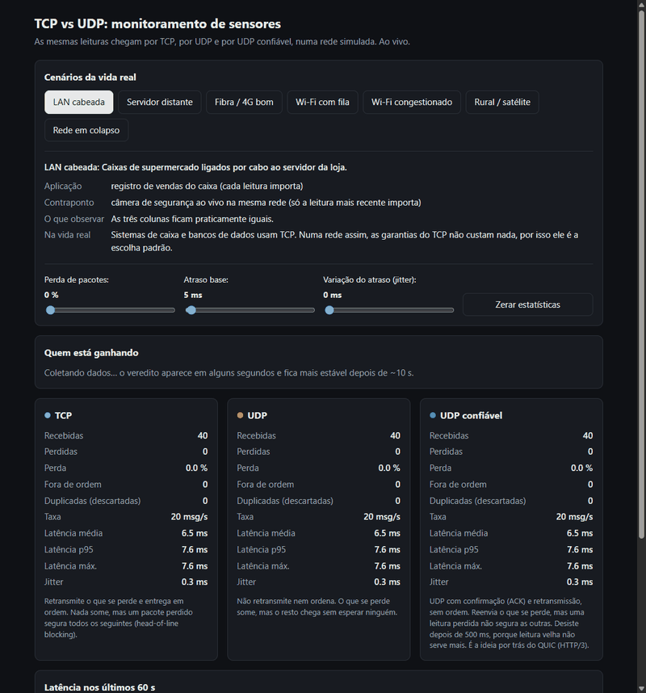

# TCP vs UDP Lab

Simulated sensors stream the same readings over **TCP**, **UDP** and a **reliable UDP** protocol built here (ACKs + retransmission), through a network you can break on purpose. A live dashboard shows loss, ordering, latency and jitter for each one, and explains which protocol wins for which real-world application.

Plain Java 21 standard library: no dependencies, no build tool.



## Run

```bash
javac -d out *.java
java -cp out Main          # collector + 5 sensors, opens http://localhost:8765
```

Other entry points:

```bash
java -cp out ServerTest                 # tests (no JUnit)
java -cp out Server                     # collector only: TCP 9001, UDP 9002, reliable UDP 9003
java -cp out Sensor --host <collector>  # sensors on another machine (--sensors, --rate, --no-rudp)
java -cp out Benchmark                  # scalability benchmark, ~3 min
```

## How it works

```
Sensor (1 thread each) ──TCP :9001──┐
                       ──UDP :9002──┼─► simulated network ─► per-protocol stats ─► dashboard (SSE)
                       ──RUDP :9003─┘   (loss, delay, jitter)       ▲
                         ◄── ACKs ──────────────────────────────────┘
```

- **Real sockets, simulated network.** Loopback never drops packets, so loss and delay are applied by the collector. UDP drops a lost datagram. TCP pays a retransmission timeout that doubles on each repeated loss, and never delivers a segment before the previous one: that is head-of-line blocking.
- **Reliable UDP** (`Sensor.rudpLoop`): every reading is ACKed, overdue readings are retransmitted, and a reading is abandoned after 500 ms, because a stale reading is useless on a live dashboard. The timeout adapts like TCP's (RFC 6298): Karn's rule, a clock-granularity floor, and exponential backoff. ACKs cross the same lossy network, so duplicates happen and are discarded.
- **Concurrency.** The collector runs one thread per TCP sensor (OS or virtual threads), one receiver per UDP port, and one delivery thread plus one lock per protocol. Code that needs every protocol takes the locks in a fixed order. Shared config is an immutable record behind a `volatile` field.
- **Scenarios.** Seven presets (wired LAN, distant server, fiber, home Wi-Fi under load, congested Wi-Fi, rural/satellite, network collapse). Each is judged for two applications with opposite needs: "every reading matters" and "only the newest reading matters".

## Results

### Which protocol wins (measured, ~13 s per scenario)

| Scenario | Every reading matters | Only the newest matters | Reliable UDP (newest matters) |
|---|---|---|---|
| Wired LAN | tie | tie | same as UDP |
| Distant server (300 ms) | tie | tie | same as UDP |
| Fiber, 1% loss | TCP | UDP | best option: 0 lost vs 6 |
| Home Wi-Fi, high jitter | TCP | UDP | middle ground |
| Congested Wi-Fi, 5% loss | TCP | UDP | best option: 0 lost vs 40 |
| Rural/satellite, 15% loss | TCP | UDP | did not help: round trip > 500 ms deadline |
| Collapse, 30% loss | nobody | nobody | best option: 67 lost vs 321, +63 ms (TCP: 900+ ms) |

High latency alone never separates the protocols; loss does. Jitter alone costs TCP only ~2 ms on average.

### Scalability: 5,000 sensors (median of 3 runs)

| | OS threads | Virtual threads | Virtual threads + one delivery thread per protocol |
|---|---|---|---|
| OS threads used | ~4,100-4,600 | 30 | 31 |
| Readings/s received (100k expected) | 60k | 69k | **87k** |
| Real UDP loss (kernel buffer overflow) | 90,071 | 3,801 | **285** |

The single delivery thread was the bottleneck (Amdahl's law): splitting it per protocol raised throughput ~26% and stabilized it. With 5,000 OS threads, oversubscription starves the critical threads, which splitting cannot fix.

## Bugs worth reading about

Each one is documented where it was fixed:

- **TCP readings out of order:** timers due at the same instant fire in any order, so deliveries go through a FIFO per connection.
- **Windows' 15.6 ms timer tick** inflated latency by ~8 ms: replaced `ScheduledExecutorService` with an `Object.wait`-based scheduler.
- **Retransmission storms:** 465 duplicates on a lossless LAN without a timeout floor, and 3,646 after a network change without backoff (Karn's rule kept discarding every sample).
- **State leaking between scenarios:** in-flight readings and old retransmissions crossing a reset are now filtered by epoch and send time.

## Security

The sensor ports listen on all interfaces, so sensors can run on another machine; everything they send is untrusted.

- Reading lines are capped at 256 chars, and malformed readings are dropped.
- Tracked senders (20,000) and open sequence gaps (200,000) are capped per protocol, so invented ids or seq jumps cannot exhaust memory.
- The dashboard listens on loopback only. It rejects any `Host` other than `localhost`/`127.0.0.1` (DNS rebinding) and any POST that is not `application/json`, which other sites cannot send without a CORS preflight that is never granted (CSRF).
- There is no authentication: run it on networks you trust.

## Limitations

- Network impairment is simulated, not real packet loss (see "How it works").
- Latency compares the sensor's clock with the collector's: exact on one machine, skewed across machines.
- Benchmark runs are few (1-3 per configuration) on a laptop that also runs the load generator.
- On Windows, latency occasionally rises ~10 ms for a while (probably power management ignoring the 1 ms timer request); it affects all protocols equally.

## Context

Academic project for a Parallel and Concurrent Computing course, built around a lecture on distributed computing challenges (latency, reliability, scalability, no global clock, concurrency). The full write-up in Portuguese, with every measurement, is in [docs/relatorio.md](docs/relatorio.md).

## License

[MIT](LICENSE)
